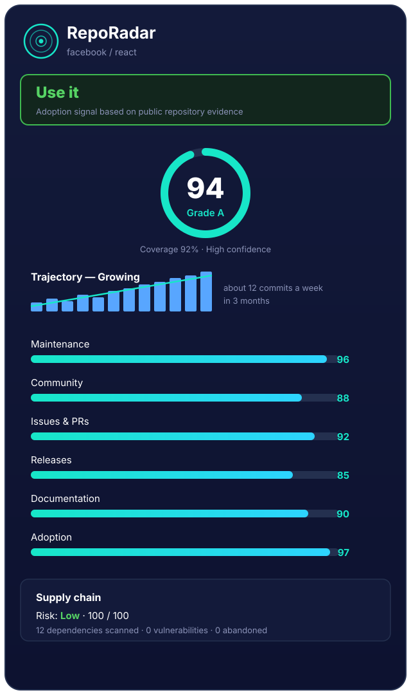
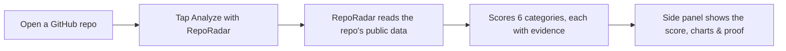
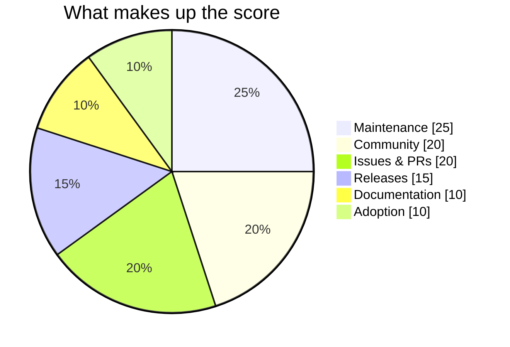

<p align="center">
  
</p>

<h1 align="center">RepoRadar</h1>

<p align="center"><strong>See how healthy a GitHub repository really is — before you depend on it.</strong></p>

<p align="center">RepoRadar is a browser extension that adds a clear, evidence-based health score to any public GitHub repository, right inside a side panel. Every number comes with its proof.</p>


## What it does

Open any public repository on GitHub and RepoRadar shows you, at a glance:

- **A health score from 0–100**, with a grade from A to F
- **Six scored categories** — maintenance, community, issues & PRs, releases, documentation, and adoption
- **The evidence behind every number** — the exact value, where it came from, and when it was observed
- **Commit activity and language breakdown** as charts
- **Save, compare and export** — keep up to 50 repositories, compare up to 3 side by side, and export a report as JSON or Markdown

No account. No server. Everything happens in your browser.

## What you see

<p align="center">
  
</p>

Tap **Analyze with RepoRadar** on any repository page and the side panel opens with the score, the six categories, the activity chart, and the language breakdown. Tap any category to see the exact evidence behind it.

## How it works



1. **Detect** — RepoRadar recognizes the repository from the page you are on.
2. **Fetch** — It reads the repository's public data from the GitHub API: commits, contributors, releases, issues, pull requests, and community files.
3. **Score** — Each category is scored from that evidence, and the overall score is the weighted result.
4. **Show** — You get the score, the charts, and every piece of evidence — including what could not be concluded.

## The health score

The score is a weighted mix of six categories:



| Grade | Score | Meaning |
| ----- | ----- | ------- |
| A | 90–100 | Actively maintained, healthy signals |
| B | 75–89 | Solid, with a few weak spots |
| C | 60–74 | Mixed signals — look closer |
| D | 40–59 | Weak maintenance signals |
| F | Below 40 | Largely inactive or unhealthy signals |

The score is an evidence-based heuristic, not a verdict on code quality or security — RepoRadar always shows you the evidence, so you can judge for yourself.

## Install

**Chrome Web Store listing coming soon.**

Until then, load it unpacked:

1. Download the latest release ZIP and extract it.
2. Open `chrome://extensions` (or `edge://extensions`) and turn on **Developer mode**.
3. Click **Load unpacked** and select the extracted `dist` folder.
4. Open any public GitHub repository and tap **Analyze with RepoRadar**.

Works on Chrome, Edge, and Brave.

## Privacy

- **Local-first** — your data stays on your device.
- **No account, no tracking, no analytics.**
- **No data sent anywhere** except the GitHub API calls needed to fetch the public repository data you asked for.
- **No token required** — it uses GitHub's public API.

## Build from source

```bash
npm install
npm run build    # production build -> .output/chrome-mv3
npm run zip      # production build + store ZIP
```

---

<p align="center">Made by <strong>Abdur Rahman Khan</strong></p>
